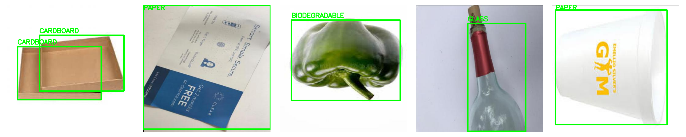
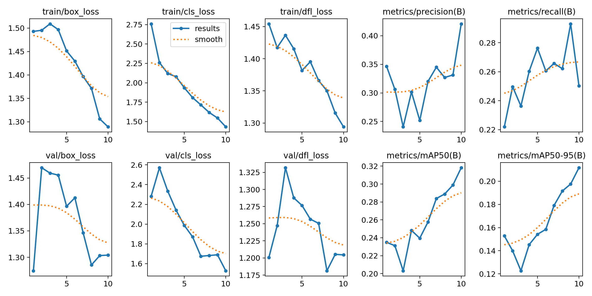
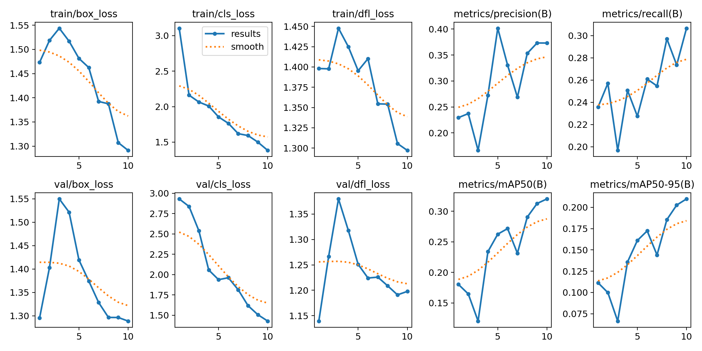
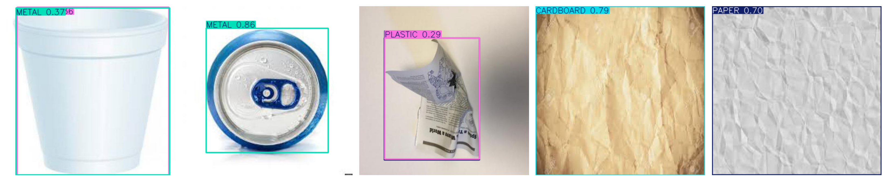
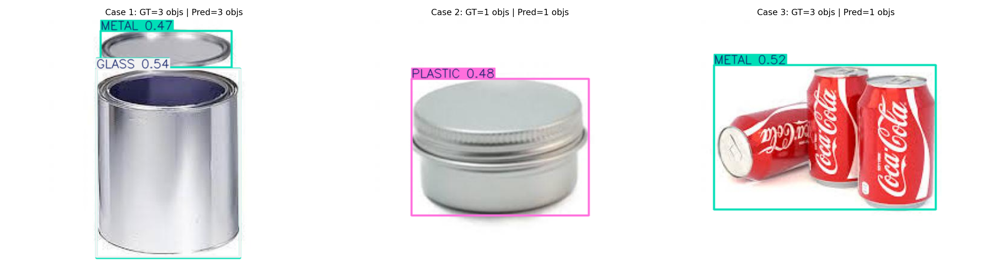

# smart-waste-detection-yolo
# Smart Waste Sorting: YOLOv8n vs YOLO11n Battle (CSCI1409 Deep Learning)

## 1. Task Description
This project builds a reproducible object detection pipeline for **automated waste sorting**. Instead of only tuning hyperparameters, we run a controlled **generation battle** comparing **YOLOv8n** (Baseline) against **YOLO11n** (Experiment) on the same 6-class garbage dataset.

---

## 2. Dataset Information
* **Source:** Public *Garbage Detection* dataset from Kaggle (`viswaprakash1990/garbage-detection`), downloaded automatically via `kagglehub`.
* **Classes (6):** `BIODEGRADABLE`, `CARDBOARD`, `GLASS`, `METAL`, `PAPER`, `PLASTIC`.
* **Annotation Format:** YOLO normalized bounding-box format (`.txt`).
* **Data Splits & Integrity Check:** Reproducible subset sampled with `seed=42`. All label files were verified with **0 empty or missing annotation files**.

| Split | Images | Annotated Objects | Empty Label Files |
| :--- | :---: | :---: | :---: |
| **Train** | 800 | 5,491 | 0 |
| **Validation** | 150 | 1,382 | 0 |
| **Test** | 150 | 487 | 0 |
| **Total** | **1,100** | **7,360** | **0** |

### Ground-Truth Annotation Samples

---

## 3. Setup and Run Instructions
1. Click the **Open in Colab** badge above.
2. Select **Runtime → Change runtime type → T4 GPU** (takes ~3 minutes total).
3. Run all cells sequentially (`Runtime → Run all`).
4. **Final Weights:** Saved in `weights/best_yolo11n.pt`.

---

## 4. Controlled Experiment: YOLOv8n vs YOLO11n
Both models were trained with identical settings: `epochs=10`, `imgsz=320`, `batch=16`, `seed=42`, `deterministic=True`, and the exact same data splits.

* **Controlled Change:** Model architecture changed from `yolov8n.pt` (Baseline) to `yolo11n.pt` (Experiment).
* **Hypothesis:** The newer `YOLO11n` architecture should achieve higher **mAP@0.50** and **Recall** on cluttered waste images while maintaining fast training speed.

### Validation Comparison (`val` split)

| Run | Model | Precision (P) | Recall (R) | mAP@0.50 | Training Time (T4 GPU) |
| :--- | :---: | :---: | :---: | :---: | :---: |
| **Baseline** | `YOLOv8n` | **0.4234** | 0.2498 | 0.3181 | 1.53 min |
| **Experiment** | `YOLO11n` | 0.3724 | **0.3038** | **0.3207** | **1.45 min** |

* **Explanation:** The hypothesis was confirmed. `YOLO11n` achieved higher **mAP@0.50** (`0.3207` vs `0.3181`), improved **Recall by +5.4 percentage points** (`0.2498 → 0.3038`), and trained slightly faster (`1.45 min`). We observed a classic Precision–Recall trade-off: `YOLOv8n` was more conservative (higher Precision), while `YOLO11n` detected more objects in dense piles. Therefore, `YOLO11n` was selected for final testing.

### Learning Curves
| Baseline (`YOLOv8n`) | Experiment (`YOLO11n`) |
| :---: | :---: |
|  |  |

---

## 5. Final Test Evaluation & Failure Analysis
The selected model (`YOLO11n`) was evaluated once on the held-out `test` split (150 images, 487 objects) at `conf=0.25` and `IoU=0.50`.

| Metric | Value |
| :--- | :---: |
| **Precision (P)** | **0.4810** |
| **Recall (R)** | **0.3140** |
| **mAP@0.50** | **0.2021** |

### Test Set Predictions (5 Examples)

### Failure Case Analysis (3 Test Examples)

1. **Case 1 (`metal100`) — Misclassification (`METAL` → `GLASS`):** Strong light reflections on the shiny metal can surface visually resemble glass glare, causing the model to label the can body as `GLASS (0.54)`.
2. **Case 2 (`metal1040`) — Misclassification (`METAL` → `PLASTIC`):** The smooth matte texture and simple cylindrical shape of the metal lid look very similar to a white plastic container (`PLASTIC 0.48`).
3. **Case 3 (`metal1165`) — Merged Box / Missed Detections (`GT=3` vs `Pred=1`):** Three red Coca-Cola cans lying next to each other were grouped into a single `METAL (0.52)` box, resulting in 2 False Negatives.

* **Practical Next Step:** Increase training epochs (from 10 to 30–50) and input resolution (`imgsz=640`) so the model can learn finer material textures (metal vs glass/plastic) and separate touching objects.

---

## 6. Limitations & AI Acknowledgment
* **Limitations:** Trained for only 10 epochs at `320×320` resolution on an 800-image subset; distinguishing visually similar materials (shiny metal, glass, plastic) requires higher resolution and longer training.
* **AI Assistance Acknowledgment:** Gemini was used to help structure the Colab notebook, debug environment setup, and draft documentation. All experiments, code execution, and error analysis were performed by the author.
